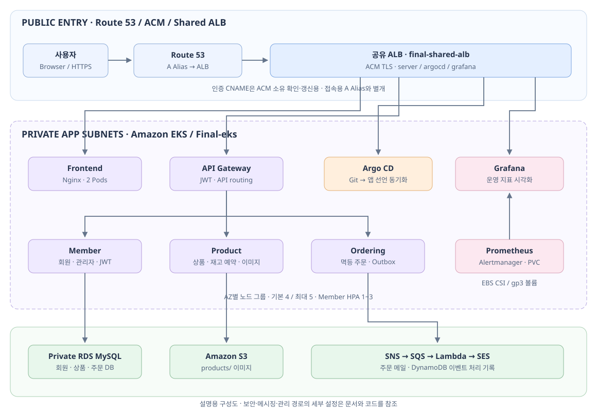
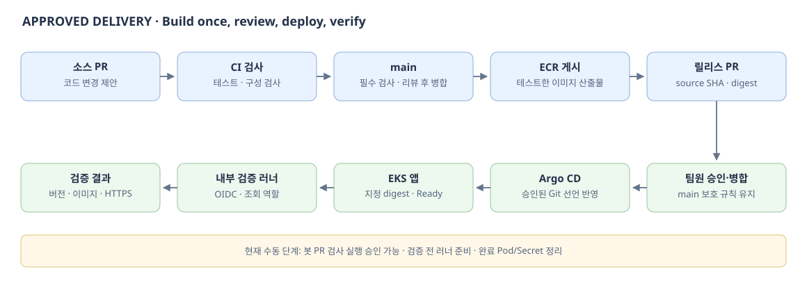

<div align="center">

# 🛒 AWS MSA DeployShop

### AWS Cloud-Native MSA · DevOps Engineering Portfolio

**Terraform IaC · Amazon EKS · Approved Delivery · GitOps · Observability**

`Infrastructure` → `Test` → `Review` → `Deploy` → `Verify`

</div>

---

> 회원·상품·주문 서비스를 AWS EKS에서 운영하며, **인프라 구축부터 승인 배포·실제 기능 검증·문제 해결까지 연결한 DevOps 프로젝트**입니다.
>
> **Project Focus** — 기술의 개수보다 “왜 이 설정이 필요한가, 누가 변경할 수 있는가, 정상 동작을 어떻게 확인하는가”를 설명하는 데 중점을 둡니다.

검증 기준일은 **2026-10-19 (KST)**입니다. 문서의 실행 결과는 해당 시점의 기록이며, 서비스 주소는 AWS 리소스 운영 기간에 유효합니다.

> **운영 상태 · 2026-10-20:** 백업에서 인프라·데이터를 복원해 실행 중입니다. [종료·재시작 기록](docs/OVERNIGHT-RESTART.md)을 참고하세요. 최종 검증·캡처·장애 훈련은 추후 진행합니다.

| 📚 문서 | 읽을 내용 |
| :--- | :--- |
| [구축 절차](docs/SETUP.md) | CLI·콘솔 역할, 의존성을 지킨 구축 순서, 완료 기준 |
| [검증 결과](docs/VALIDATION.md) | 배포·HTTPS·주문·재고·메일·자동 확장의 실제 결과 |
| [트러블슈팅](docs/TROUBLESHOOTING.md) | 증상 → 원인 → 조치 → 검증 → 재발 방지 |
| [장애 훈련 5가지](docs/10-live-validation.md) | 이미지·API·부하·DB 연결·데이터 복원의 계획·결과 입력란 |
| [증거 목록](docs/EVIDENCE.md) | Actions·승인 PR·manifest·기록의 연결, 추가할 캡처 |
| [교육 복습노트_검증 및 시나리오](docs/learning/교육%20복습노트_검증%20및%20시나리오.md) | 사이트·콘솔·Postman·Grafana 직접 조작·5개 시나리오·캡처 순서 |
| [교육·복습 노트](docs/learning/STUDY-NOTES.md) | 실행 순서마다 용어·설정 이유·인과관계를 풀어 읽는 상세 설명서 |
| [배포·보안 상세](docs/14-security-and-verification.md) | digest·내부 일회용 러너·OIDC·조회 전용 권한 |

## 01. System Architecture



브라우저는 Route 53으로 주소를 찾고 ALB에 HTTPS 요청을 보냅니다. ALB는 도메인·경로에 따라 frontend·apigateway 또는 관리 도구로 전달합니다. **앱 노드와 RDS는 프라이빗 영역에 배치**하며, RDS를 Workbench 실습용으로 외부 공개하지 않습니다.

| 접속 주소 | 대상 | 전달 방식 |
| :--- | :--- | :--- |
| [server.aws-yjeee.com](https://server.aws-yjeee.com) | 쇼핑몰·서비스 API | frontend / apigateway 경로 분기 |
| [argocd.aws-yjeee.com](https://argocd.aws-yjeee.com) | Argo CD | 같은 ALB의 host 규칙 |
| [grafana.aws-yjeee.com](https://grafana.aws-yjeee.com) | Grafana | 같은 ALB의 host 규칙 |

ACM 인증용 **CNAME**은 인증서 발급·갱신에, 서비스 **A Alias**는 도메인과 ALB 연결에 사용합니다. 세 도메인은 공유 ALB 하나를 사용합니다. [네트워크·자원 관리 상세](docs/01-architecture.md)

## 02. Core Services & Tools

| 서비스 | 역할 | 이미지 저장소 |
| :--- | :--- | :--- |
| 👤 Member | 회원가입·JWT·관리자 권한·회원 조회 | `member-service` |
| 📦 Product | 상품·재고 예약·이미지 S3 업로드 | `product-service` |
| 🛒 Ordering | 멱등 주문·복구 상태 관리·Outbox | `ordering-service` |
| 🌐 API Gateway | 경로 라우팅·JWT 검증·외부 내부 API 접근 제한 | `apigateway` |
| 🖥️ Frontend | 쇼핑몰·관리자 화면 | `frontend-service` |

API Gateway는 AWS 관리형 API Gateway가 아니라 EKS에서 실행하는 Spring 기반 앱입니다.

| 영역 | 사용 기술 |
| :--- | :--- |
| Cloud / IaC | AWS · Terraform Root + Child Modules · S3 Remote State·Lock |
| Runtime / Network | Docker · ECR · EKS · ALB Controller · Route 53 · ACM |
| Delivery | GitHub Actions · 승인 PR · 이미지 digest · Argo CD · Helm · Kustomize |
| Security | OIDC · IAM 역할 분리 · EKS Access Entry / RBAC · Secrets Manager · External Secrets |
| Scaling / Storage | Metrics Server · HPA · Cluster Autoscaler · EBS CSI · PVC |
| Messaging / Observability | Outbox · SNS · SQS / DLQ · Lambda · SES · DynamoDB · Prometheus · Grafana · CloudWatch · CloudTrail |

## 03. CI/CD & Approved GitOps



**코드 PR**은 소스 변경을, **릴리스 PR**은 실제 배포할 이미지 조합을 검토합니다. main 보호는 필수 CI와 다른 팀원의 승인 1건을 요구합니다.

| 단계 | 수행하는 일 | 다음 단계의 기준 |
| :--- | :--- | :--- |
| Test | 변경 서비스 테스트·이미지 빌드·설정 검사 | required-ci 성공 |
| Publish | 테스트한 이미지 산출물을 다시 빌드하지 않고 ECR에 게시 | SHA 태그·digest 확보 |
| Review | `release.json`과 Kustomize의 이미지 변경 검토 | 팀원 승인·보호 규칙 충족 |
| Deploy | Argo CD가 main의 선언을 EKS에 반영 | Synced·Healthy·Ready |
| Verify | 내부 러너가 배포 버전·이미지·HTTPS·상품 API 검사 | 실제 검증 job 성공 |

**태그는 이름표, digest는 특정 이미지의 식별값**입니다. `member-service@sha256:…`처럼 승인한 결과물을 지정해 실행합니다. Git 커밋 번호는 소스를, digest는 이미지를, 배포 commit은 반영한 선언을 추적합니다. [이미지 고정 자세히](docs/02-deployment.md)

현재는 GitHub App과 검증 러너 자동 공급이 미적용입니다. 기본 토큰으로 만든 봇 PR은 검사 실행 승인이 필요할 수 있고, 내부 러너는 검사 전에 수동 시작합니다. **사람의 리뷰 승인과 워크플로 실행 승인은 별개**입니다.

## 04. Order Processing & End-to-End Validation

```text
웹 / API 주문 + Idempotency-Key
  → Gateway 인증 → 회원 확인·상품 재고 예약 → 주문 완료
  → 주문 DB·Outbox 기록 → 주문 SNS → SQS → Lambda → SES
                                                   ↕
                                              DynamoDB 처리 기록
```

Idempotency-Key는 네트워크 오류 등으로 같은 주문을 재요청할 때 중복 효과를 막는 요청 식별자입니다. 장바구니는 상품별 주문이며 전체가 하나의 결제 거래는 아닙니다.

| 검증 순서 | 실제 결과 |
| :--- | :--- |
| 테스트 상품·이미지 등록 | 상품 ID `1`, 재고 `10`, S3 이미지 HTTPS `200` |
| 수량 1개 주문 | 주문 ID `1`, `ORDERED`, 재고 `9` |
| 동일 키·동일 내용 재요청 | 같은 주문 ID, 재고 `9` 유지 |
| 메일 이벤트 처리 | DynamoDB 이벤트 1건 `SENT`, SQS 대기·처리 중·DLQ 모두 `0` |

메일 `SENT`는 SES 발송 수락까지 확인한 결과입니다. 받은편지함 도착이나 정확히 한 번 발송을 보장하지 않습니다. 이 표는 API 결과를 대조한 것이며 별도 SQL SELECT 캡처가 있다는 뜻은 아닙니다. [결과와 검증 범위](docs/VALIDATION.md)

## 05. Scaling & Observability

| 구성 | 역할 | 현재 프로젝트에서 확인한 범위 |
| :--- | :--- | :--- |
| Member HPA | CPU 목표 60%, Pod 1~3개 | 설정·지표 조회 확인; 부하 확장·축소 실습은 별도 |
| Cluster Autoscaler | AZ별 노드 그룹, 기본 4·최대 5대 | 초기 배치 자원 부족 시 `4 → 5`대 확장 관찰 |
| Prometheus / Grafana | 앱·노드 지표, 대시보드 | 도구 정상 실행·Grafana HTTPS 확인 |
| Alertmanager / SNS | Kubernetes 운영 경보 전달 | 운영 SNS 구독 확인; 합성 장애 알림 검증은 별도 |
| CloudWatch / CloudTrail | AWS 지표·경보·관리 로그·작업 이력 | 인프라 구성; 시나리오별 증거 추가 필요 |
| EBS / PVC | 모니터링 데이터 영구 저장 | Grafana 1Gi, Prometheus 5Gi, Alertmanager 1Gi 선언 |

HPA는 Pod 수를, CA는 노드 수를 바꿉니다. CA는 단순히 CPU가 높다는 이유로 작동하는 것이 아니라 배치할 수 없는 Pod와 자원·배치 조건을 판단합니다. [모니터링](docs/03-monitoring-and-tests.md) · [장애 검증 계획](docs/10-live-validation.md)

## 06. Security & Verification Runner

| 설계 | 이유 |
| :--- | :--- |
| EKS 관리 IP `/32` + private endpoint | 외부 관리 접근 범위를 제한하고 내부 관리 경로 유지 |
| VPC 내부 runner Pod | GitHub 표준 러너에서 닿기 어려운 EKS 관리 API 검사 |
| 일회용·main 전용 | 승인된 코드의 검사 한 번 후 종료·등록 해제 |
| OIDC 임시 AWS 자격증명 | 장기 AWS 키를 workflow에 저장하지 않고 역할 사용 |
| 조회 전용 역할·RBAC | Deployment·지정 Argo Application만 읽기, 변경·Secret 조회 권한 미부여 |
| non-root·권한 상승 제한·호스트 socket 미연결 | 검사에 불필요한 권한과 제어 경로 축소 |
| Secrets Manager → ESO | DB 비밀번호를 Git 밖에서 관리·주입 |

러너는 “작업 명령을 실행하는 컴퓨터”입니다. 이번 구성에서는 기존 EKS에 임시 Pod로 실행하므로 검사마다 EC2 한 대를 새로 만드는 방식은 아닙니다. 종료 뒤 완료 Pod·등록 Secret 정리는 별도 단계입니다. [용어부터 이해하기](docs/14-security-and-verification.md)

## 07. Troubleshooting Highlights

| 문제 | 원인·조치 | 확인한 결과 |
| :--- | :--- | :--- |
| 일부 앱 Pending | 메모리·Pod 자리 부족 → CA가 노드 추가 | 5개 앱 Deployment 정상·최종 앱 재시작 0회 |
| Lambda 생성 실패 | 계정 예약 동시 실행 한도 → 예약 해제·SQS 소비 상한 2 | 함수·event source mapping 생성·Enabled |
| 이미지 갱신 테스트 실패 | 고정 digest가 있는 manifest를 테스트가 잘못 가정 → 선택 서비스만 비교 | Python 회귀 검사 18개·필수 CI 성공 |
| 운영 이메일 주소 오타 | 미확인 구독 정리 후 올바른 주소로 재설정 | SNS 실제 구독 ARN·SES 인증 성공 |

각 사례의 증상·원인·명령·복구 판정은 [트러블슈팅](docs/TROUBLESHOOTING.md)에 기록합니다. 다른 환경의 장애 사례와 현재 결과를 섞지 않습니다.

## 08. Repository Structure & Ownership

```text
aws-msa-final-project-test/
├── terraform-state-bootstrap/   # state S3: 독립 local state·보관
├── terraform/                   # AWS 리소스·S3 remote state
├── terraform-k8s/               # Helm 도구·Secret·RBAC·관리 Ingress
├── app/msa/                     # 5개 앱·Argo가 읽는 Kustomize 선언
├── .github/workflows/           # 테스트·게시·릴리스 제안·배포 검증
├── deploy/release.json          # 이미지 source·digest·릴리스 정보
├── scripts/                     # 검사·러너·복원·롤백 도구
└── docs/
    ├── SETUP.md                 # 구축 순서와 관리 경계
    ├── VALIDATION.md            # 실제 결과
    ├── TROUBLESHOOTING.md       # 원인 분석과 해결
    ├── EVIDENCE.md              # 증거 인덱스
    ├── learning/STUDY-NOTES.md  # 명령·의미·정상 결과
    └── images/                 # 현재 구조의 설명용 SVG
```

VPC·EKS·IAM·RDS·메시징·인증서·DNS는 AWS Terraform 루트가 관리합니다. Helm 운영 도구는 Kubernetes Terraform 루트, 앱은 Argo CD가 관리합니다. ALB는 Controller가 Ingress를 읽어 생성합니다. 기존 Route 53 zone은 재사용합니다. 콘솔에서 인증·관찰·선택 수동 생성을 할 때도 소유 자원을 구분합니다.

## 09. Evidence & Operations Scope

- [승인·병합 PR #1](https://github.com/yjeee-ghub/aws-msa-final-project-test/pull/1) · [실제 배포 검증 성공](https://github.com/yjeee-ghub/aws-msa-final-project-test/actions/runs/39236432516)
- 검증한 배포 commit: `94915e5c8eb56143ab556b0136396ba9fc95eec2`. Argo `Synced / Healthy`, 두 Terraform 루트 `No changes`를 확인했습니다.
- SVG는 설계 설명용 구성도입니다. 실제 콘솔 캡처·로그 원본으로 취급하지 않습니다. [증거별 의미와 캡처 계획](docs/EVIDENCE.md)
- 프런트엔드 2개, 일부 단일 백엔드·운영 도구, Single-AZ RDS, 단일 NAT 구성입니다. 모든 장애에서 무중단은 아닙니다.
- DB·state·CloudTrail은 공개하지 않습니다. 상품 이미지 S3는 `products/` 객체 읽기만 공개합니다.
- DB 중단·강제 DLQ·비밀번호 회전·별도 DB 복원·실제 롤백은 추가 실습 대상입니다. 구성 존재와 실습 성공을 구분합니다.
- state·tfvars·plan·키·비밀번호는 Git에 올리지 않습니다. 정리 전 RDS 스냅샷·EBS·S3·ECR·state 보존 범위를 확인합니다.

[상세 설계](docs/01-architecture.md) · [롤백](docs/ROLLBACK.md) · [변경 이력·출처](docs/15-change-history.md)

---

<div align="center">

**설정 이유 · 실행 순서 · 실제 검증 · 문제 해결을 연결한 DevOps 포트폴리오**

</div>
